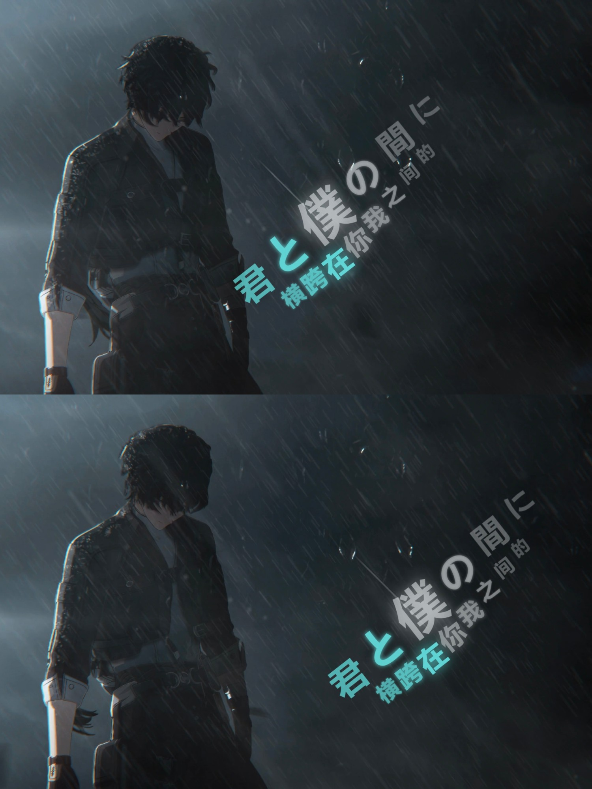
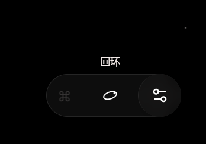
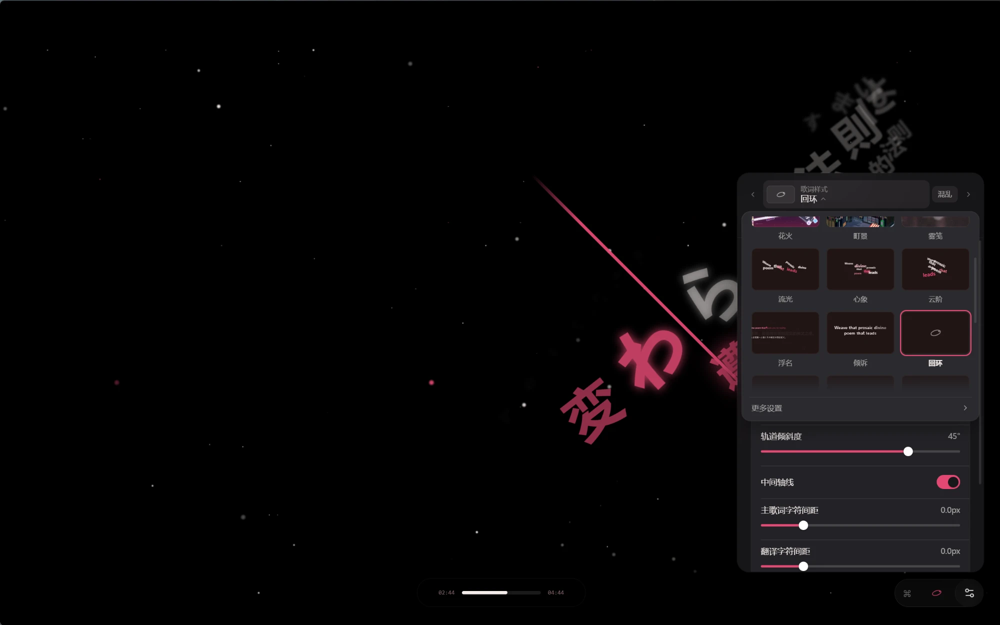

# Folia 补丁

给 [Folia](https://github.com/chthollyphile/folia-major) 0.7.25 加几项功能的补丁程序。分成两个包，可以单独装，也可以一起装，随时能卸载。

## 补丁包

### 歌词样式按钮（`lyric-style-button`）

播放页右下角，⌘ 提示和侧边面板按钮之间，多一个当前歌词样式的图标：

- 和右侧按钮一起显示、一起自动隐藏。
- 鼠标停在图标上滚动滚轮，切换上一个 / 下一个歌词样式；图标上方用小字显示样式名称。
- 单击打开歌词样式设置卡片：顶部可以选样式和动画强度，下面是和设置页一样的「歌词动画 / 背景 / 字体 / 字幕 / 全局」标签。拖动滑块时画面实时变化。
- 点击卡片外面任何地方关闭卡片。

### 莫奈 / 回环 / 时计增强（`lyric-styles-plus`）

- **莫奈**
  - 头像来源增加「关闭」。
  - 「歌词左右镜像」：封面移到左边，文字靠右，封面、文字到屏幕边缘的距离和原版对称。
  - 「显示歌曲描述」下面可以填自定义描述，留空则用原来的描述。
- **回环**
  - 「左右位置」「上下位置」：移动画面中间的圆环。
  - 「显示翻译」：翻译显示在每句歌词下方，可以单独调翻译的放大倍率和字符间距。
- **时计**
  - 「歌词左右镜像」：表盘移到右边，歌词弧线在左边。

## 截图

**莫奈：左右镜像（上：原版，下：镜像）**


**莫奈：头像来源「关闭」（上：原版布局，下：镜像布局）**


**回环：显示翻译（上：关，下：开）**


**回环：调整圆环位置**



**时计：左右镜像**


**歌词样式按钮：滚轮切换时显示样式名称**



**歌词样式按钮：设置卡片**


**歌词样式按钮：卡片里的样式选择器**



## 安装

1. **完全退出 Folia**（托盘图标也要退出）。
2. 下载本仓库（绿色的 Code 按钮 → Download ZIP），解压。
3. 双击 `Folia-Patcher.bat`，按提示选择要装的包。
   - 程序会请求管理员权限（Folia 通常装在 `Program Files` 下，修改需要权限），在弹出的窗口里点「是」。
   - 程序会自动在常见位置找 Folia；找不到时会让你输入 Folia 的安装目录。
4. 重新打开 Folia。

不需要另外安装 Node.js，程序借用 Folia 自带的运行环境。

也可以在命令行里用：

```bat
Folia-Patcher.bat status
Folia-Patcher.bat install all
Folia-Patcher.bat install lyric-style-button
Folia-Patcher.bat uninstall lyric-styles-plus
Folia-Patcher.bat restore-backup
```

Folia 不在常见位置时，加上 `--folia "Folia 安装目录"`。

## 卸载与还原

- 菜单里的「全部卸载」把改过的文件逐条换回原样，卸载后和原版一模一样。
- 第一次安装时，程序会把当时的 `resources\app.asar` 备份成 `app.asar.folia-patcher.bak`。万一出问题，选「用备份还原 app.asar」即可。

## 注意

- 只支持 **Folia 0.7.25**。其他版本、或者 Folia 已经被别的方式改过时，程序会显示「版本不匹配」并拒绝安装，不会改动任何文件。
- Folia 自动更新后，补丁会被覆盖掉。如果新版本的代码没有变，可以重新运行安装；变了的话需要等补丁更新。
- 补丁直接修改 Folia 的程序文件，不是 Folia 的模组，所以不在模组市场里。

## 工作原理

`packs/` 里的每个 JSON 文件是一个补丁包，记录要改的文件、原文件和改后文件的 SHA-256，以及一组「找到这段原文 → 换成这段新内容」的规则。安装时：

1. 读取 `app.asar`，检查每个目标文件的哈希，确认是原版 0.7.25 或已安装状态。
2. 逐条套用规则，每段原文必须恰好出现一次，结果的哈希必须和预期一致，否则放弃。
3. 写入新的 `app.asar`（先写临时文件，成功后再替换），其余文件原样保留，`app.asar.unpacked` 不动。
4. 写完后重新读取校验一次。

`patcher.js` 不依赖任何第三方库。

## 许可证

Folia 以 AGPL-3.0 发布，补丁规则里包含 Folia 的代码片段，因此本项目同样以 [AGPL-3.0](LICENSE) 发布。
